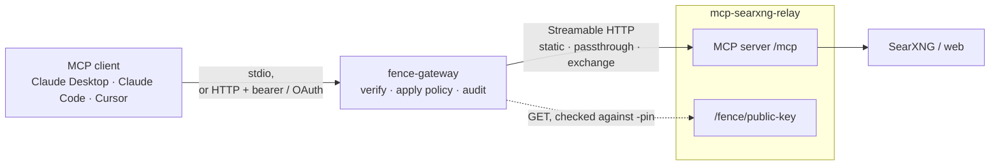

# fence-gateway

A verifying security gateway for prompt fencing: it checks the Ed25519 signature on
every tool response from [mcp-searxng-relay](https://github.com/littleoffice/mcp-searxng-relay)
before the content reaches the model. An independent implementation of the security
gateway in [Peh, S. (2025), "Prompt Fencing: A Cryptographic Approach to Establishing
Security Boundaries in Large Language Model Prompts", arXiv:2511.19727](https://arxiv.org/abs/2511.19727)
(*the paper*, §4.5 and §7.4.3).

**Why it exists.** The relay signs every tool response. Until something checks those
signatures they are decoration — the relay's own `fence.go` says so in capitals. This is
the checker: the component that performs deterministic verification so the model never
has to. The model cannot be its own security verifier.

**Who this is for.** Teams running the relay who want its signatures enforced, not just
emitted. The gateway sits between the MCP client and the relay, verifies every result
on the way back, and under the default policy withholds anything that fails, writing
the reason to an audit log a person reads.

**Status: proof of concept.** Verified against output from the relay's unmodified
`fence.go` ([Testing](docs/testing.md)), but not externally audited.

The gateway speaks both MCP transports: **stdio** for local clients such as Claude
Desktop, and **Streamable HTTP** to serve a whole team from one instance.

---

## Contents

- [Features](#features)
- [Architecture](#architecture)
- [Quick start](#quick-start)
- [Policies](#policies)
- [Configuration](#configuration)
- [Security notes](#security-notes)
- [Documentation](#documentation)
- [Companion projects](#companion-projects)
- [Attribution](#attribution)
- [License](#license)

---

## Features

- **[Signature verification](docs/verification.md)** — every fence candidate is tried and the signature decides which are real; no pattern a page could steer picks the fence.
- **[Policies](docs/verification.md#policies)** — `reject` withholds a failing result, `annotate` forwards it flagged, `audit` only logs.
- **[Layout checks](docs/verification.md#response-layout)** — a removed, swapped or spliced preamble fails even though each remaining signature verifies, and so does unsigned text beside a 1.1 response.
- **[Downgrade detection](docs/verification.md#format-versions)** — a response in an older fence format than the relay reports, or than `-fence-version` allows, fails.
- **[Freshness](docs/verification.md#freshness)** — fences older than `-max-age` (10 minutes by default), or dated in the future, are refused, so cached or replayed output cannot re-enter a session.
- **[Key pinning and rotation](docs/verification.md#key-trust)** — `-pin` the relay's key; each fence names its key, and keys from rotations and replicas are looked up as they appear.
- **[Unfenced text refused](docs/verification.md#text-without-a-fence)** — a relay that leaves the fence out gets nothing through, apart from its fixed no-results reply and labelled error messages.
- **[Authentication](docs/configuration.md#http-mode)** — static bearer tokens or [OAuth 2.0 / OIDC](docs/configuration.md#oauth-20--oidc) in HTTP mode, with cross-origin and DNS-rebinding protection and a failed-login throttle.
- **[Per-caller identity at the relay](docs/configuration.md#which-credential-reaches-the-relay)** — forward each caller's credential, or exchange it for a relay token (RFC 8693), so callers keep their own history and rate limits.
- **[Audit log](docs/observability.md#audit-log)** — every outcome logged with the tool and the caller; attacker-controlled text goes only to the log, never to the model.
- **[Metrics](docs/observability.md#metrics)** — the gateway's own Prometheus series, and the relay's forwarded, behind a token of their own.
- **[Reproducible builds](docs/installation.md#building-the-container-image)** — a `FROM scratch`, non-root, statically linked image whose manifest rebuilds byte-identically. See the [supply-chain statement](docs/supply-chain.md).

---

## Architecture



**What each leg enforces.**

| Leg | Control | Failure mode it prevents |
|---|---|---|
| client → gateway | Bearer token or OAuth JWT, cross-origin and DNS-rebinding protection, failed-login throttle | Unauthenticated use of the gateway |
| gateway → relay | `UPSTREAM_MCP_AUTH_MODE`: each caller's own credential (`passthrough`, `exchange`) | Callers sharing one relay identity, fetch history and rate limit |
| key endpoint → gateway | `-pin` | A substituted relay serving a key of its own |
| relay → client (return path) | Signature, `kid`, freshness, layout, format version, then the policy | Forged, tampered, spliced, replayed or unfenced content reaching the model |

All of it depends on one deployment rule: **only the gateway may reach the relay.** A
client that can reach the relay directly gets its output unverified. How to enforce
that: [Deployment](docs/deployment.md).

How the proxy is wired inside, and one tool call step by step: [Architecture](docs/architecture.md).

---

## Quick start

You need a running relay, its fence key fingerprint (from the relay's startup banner),
and a token the relay accepts.

```bash
docker run --rm -i \
  -e UPSTREAM_MCP_TOKEN="$RELAY_TOKEN" \
  ghcr.io/littleoffice/fence-gateway:latest \
  -upstream https://relay.internal:8080/mcp -pin 5fb07c6222c503de -policy reject
```

Then point your MCP client at the gateway instead of the relay. Claude Desktop, HTTP
mode, building from source and the container image are in
[docs/installation.md](docs/installation.md).

---

## Policies

What a verification failure leads to, set with `-policy`:

| Policy | The model receives | Stops an attack |
|---|---|---|
| `reject` (default) | a fixed error result, nothing from the tool | yes |
| `annotate` | the tool's content, `isError` set, a warning prepended | no |
| `audit` | the tool's content unchanged | no |

What counts as a failure: [docs/verification.md](docs/verification.md#what-counts-as-a-failure).

---

## Configuration

Verification behaviour is set by flags, deployment by environment variables. Most
deployments set these:

| Setting | Purpose |
|---|---|
| `-upstream` | The relay's MCP endpoint |
| `-pin` | The relay's key fingerprint; pair it with a persistent relay key ([why](docs/verification.md#key-trust)) |
| `-fence-version 1.1` | Require the signed preamble, once the relay runs with `FENCE_PREAMBLE=fenced` |
| `UPSTREAM_MCP_TOKEN` / `_FILE` | The gateway's own credential for the relay |
| `MCP_PORT` | Serve Streamable HTTP on this port; unset means stdio |
| `MCP_AUTH_TOKEN` / `MCP_AUTH_TOKENS` / `MCP_AUTH_TOKEN_FILE` | Bearer token(s) clients present in HTTP mode, or use [OAuth 2.0 / OIDC](docs/configuration.md#oauth-20--oidc) instead |
| `UPSTREAM_MCP_AUTH_MODE` | Which credential reaches the relay; required with more than one caller ([details](docs/configuration.md#which-credential-reaches-the-relay)) |

Every flag and variable, with its default: [docs/configuration.md](docs/configuration.md).

---

## Security notes

**The setup to run.** Each step closes a gap the one before leaves:

1. **Pin the relay's key.** Give the relay a persistent key (`FENCE_SIGNING_KEY_FILE`)
   and start the gateway with `-pin`. Without a pin, a substituted relay passes
   verification with a key of its own.
2. **Require format 1.1.** Run the relay with `FENCE_PREAMBLE=fenced` and the gateway
   with `-fence-version 1.1`. Under 1.0 the preamble is unsigned prose that anyone on
   the gateway→relay path can rewrite.
3. **Keep `-policy reject`.** The other two policies describe an attack; only `reject`
   stops one.
4. **Let only the gateway reach the relay.** Otherwise a client can skip it.
5. **Give each caller their own identity** with `passthrough` or `exchange` when more
   than one caller shares the gateway.

**What verification does not do.** A signature proves which bytes the relay emitted, not
that they are safe to act on. Instructions written into a fetched page arrive inside a
genuine fence. The signed preamble tells the model to treat them as data; under format
1.1 the gateway guarantees that preamble is present and intact, not that the model obeys
it.

**How the code was written.** The project is entirely AI-generated: an AI assistant
(Claude) wrote the code, the documentation, and the build and deployment files. One
maintainer directs the work, decides which changes are merged, and builds and tests
every release. What that means for a reviewer is in the
[development process](docs/supply-chain.md#development-process).

Report vulnerabilities privately: [docs/SECURITY.md](docs/SECURITY.md).

---

## Documentation

| Document | Contents |
|---|---|
| [Installation](docs/installation.md) | Building, the container image, Claude Desktop, reproducible builds |
| [Configuration](docs/configuration.md) | Every flag and environment variable; HTTP mode, OAuth, credential modes, metrics |
| [Architecture](docs/architecture.md) | Components, how the proxy is wired, one tool call step by step, transports |
| [Verification](docs/verification.md) | Policies, what counts as a failure, layout, format versions, freshness, key trust |
| [Deployment](docs/deployment.md) | Keeping the relay reachable only from the gateway, with Compose and searxng-helm |
| [Token exchange](docs/token-exchange.md) | `UPSTREAM_MCP_AUTH_MODE=exchange` with authentik and Keycloak |
| [Logging and metrics](docs/observability.md) | Audit events, Prometheus series |
| [Design notes](docs/design-notes.md) | Where the paper and the relay disagree, and what building this found |
| [Testing](docs/testing.md) | What the tests cover, and the interop vectors from the relay |
| [Enforcement profile](docs/specification.md) | The gateway's rules as numbered requirements, each tied to code and tests |
| [Conformance](docs/conformance.md) | How the gateway maps onto the paper's security gateway |
| [Supply-chain statement](docs/supply-chain.md) | How the code was written, dependencies, build provenance, known gaps |
| [Security policy](docs/SECURITY.md) | Supported versions and how to report a vulnerability |

---

## Companion projects

- **[mcp-searxng-relay](https://github.com/littleoffice/mcp-searxng-relay)** — the MCP
  server whose responses this gateway verifies: web search and URL fetching through
  your own SearXNG, with every response in a signed `<sec:fence>`. Its
  [fence verification contract](https://github.com/littleoffice/mcp-searxng-relay/blob/main/docs/fence-verification.md)
  is the wire format this gateway implements.
- **[searxng-helm](https://github.com/littleoffice/searxng-helm)** — a Helm chart that
  deploys SearXNG and the relay on Kubernetes; it mounts the relay's persistent fence
  key, and [Deployment](docs/deployment.md#kubernetes--searxng-helm) shows how to put
  the gateway in front.

---

## Attribution

This project is an independent implementation of the work described in "Prompt Fencing: A Cryptographic Approach to Establishing Security Boundaries in Large Language Model Prompts" Peh S.

I read the paper and found the research interesting, and built this project as an engineering implementation of the ideas presented in it. The research, ideas, and methodology are attributed to the original author. The system architecture, engineering direction, integration, testing, and repository are my work, with AI-assisted development used extensively in implementing the code.

---

## License

The paper is CC BY 4.0. This implementation is offered under the Apache License 2.0; see [LICENSE](LICENSE).
