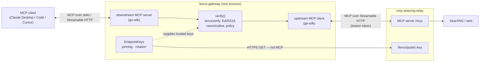
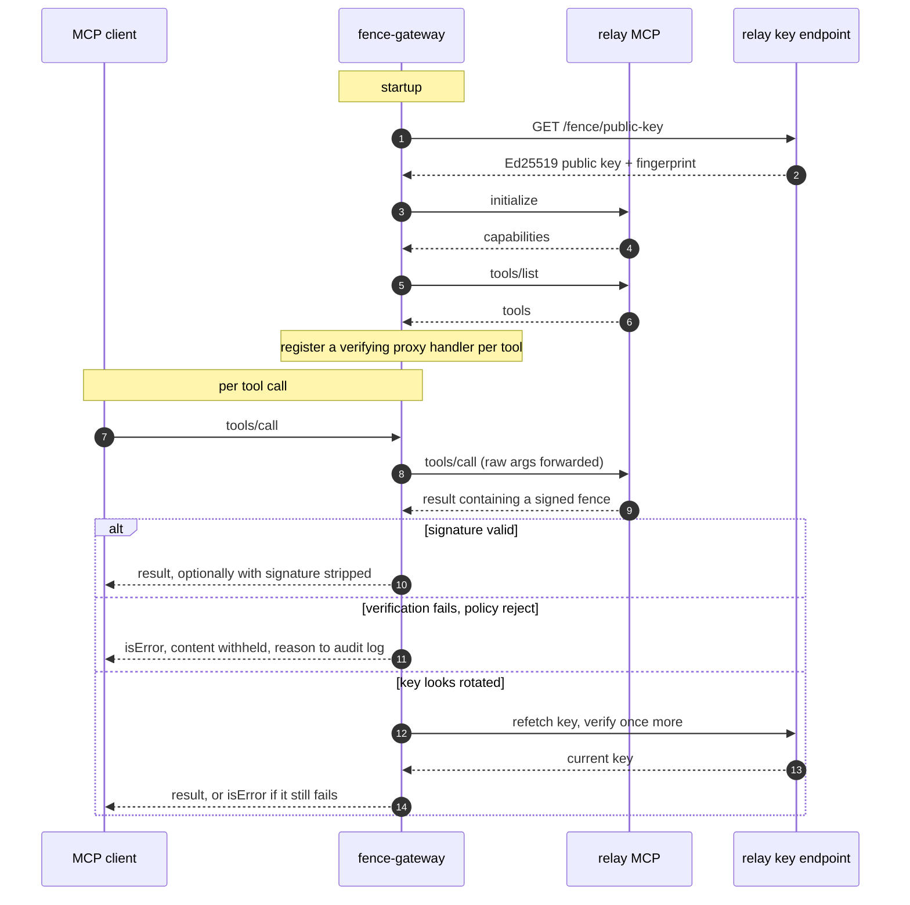

# Architecture

How the gateway is put together, and what happens on one tool call.

## Contents

- [Components](#components)
- [How the proxy is wired](#how-the-proxy-is-wired)
- [One tool call](#one-tool-call)
- [Transports](#transports)

## Components

| | |
|---|---|
| `fenceverify` | Package: parsing, canonicalisation, signature verification, key acquisition. No I/O in the hot path. |
| `fence-gateway` (module root, `package main`) | MCP proxy. Verifies tool results in transit and enforces a policy. This is the binary the `Dockerfile` builds. |
| `interop` | Interop test package: verifies output from the relay's unmodified `fence.go`. See [Testing](testing.md). |

A standalone `fence-verify` CLI (read a fenced payload on stdin, exit 0/1/2, for
CI gates and incident triage) is described in the paper's tooling and is a
natural next addition on top of the `fenceverify` package, but is not yet
implemented in this repository.

## How the proxy is wired

The transport is delegated to the [MCP go-sdk](https://github.com/modelcontextprotocol/go-sdk)
— the same SDK the relay uses. The gateway is an **MCP server** to the
downstream client and an **MCP client** to the upstream relay, bridging the two
with fence verification injected on the return path. Verification itself
(`fenceverify`) is transport-agnostic and depends only on the standard library.

The return-path check is the whole point (§7.4.3): the model cannot be its own
security verifier, so a component in the transport does the deterministic
signature check before any bytes reach the model.

## One tool call

What counts as "verification fails" is in [Verification](verification.md).

## Transports

The diagrams show the proxy's wiring. The client↔gateway leg runs over one of
two transports, sharing the same verifying proxy core:

- **stdio** (default) — a local subprocess of the MCP client. This is the
  per-workstation shape.
- **Streamable HTTP** (`MCP_PORT` set) — a network server, so one gateway can
  sit in front of the relay for a whole fleet instead of being installed on
  every workstation. Bearer or OAuth authentication and CSRF protection sit in
  front of the downstream server.

Configuration splits cleanly: **verification behaviour is set by flags**
(`-upstream`, `-policy`, `-pin`, `-max-age`, `-strip-signature`,
`-require-all-fenced`, `-fence-version`, `-paper-scheme`, `-tofu`, `-key-url`), and
**deployment is set by environment variables** (mirroring the relay's names).
The tokens clients present *to the gateway* in HTTP mode are the
`MCP_AUTH_TOKEN*` family. What the gateway presents *to the relay* depends on
`UPSTREAM_MCP_AUTH_MODE`: each caller's own credential, forwarded, an exchanged
token, or the gateway's `UPSTREAM_MCP_TOKEN` for everyone. Which one you want is
not a detail — see
[Which credential reaches the relay](configuration.md#which-credential-reaches-the-relay).
