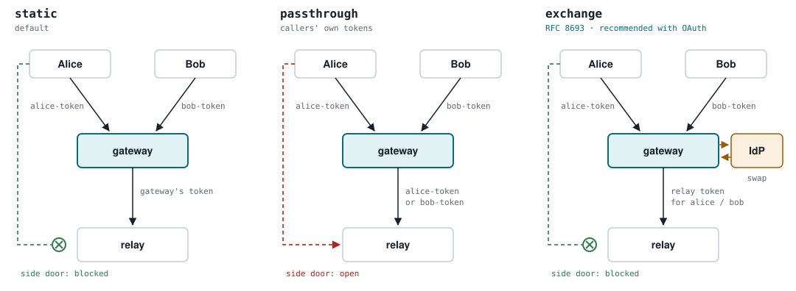

# Deploying the gateway in front of the relay

The gateway only protects what passes through it. If a client can also reach
the relay directly, it gets the relay's output unverified. So the one rule for
every deployment is:

**Only the gateway may reach the relay.**

How much depends on that rule changes with `UPSTREAM_MCP_AUTH_MODE`:

| Mode | A caller who reaches the relay directly… | Network isolation is |
|---|---|---|
| `static` | has no token the relay accepts | recommended |
| `passthrough` | **has one: their gateway token works at the relay too** | **required** |
| `exchange` | has a token made for the gateway, which the relay refuses | recommended, as a second layer |

<picture>
  <source media="(prefers-color-scheme: dark)" srcset="diagrams/relay-credential-modes-dark.svg">
  
</picture>

In `passthrough` mode the gateway logs `upstream.auth.passthrough` at startup
as a reminder, because it cannot see the network itself.

Three things make the rule hold:

1. **The relay is not published.** No host port, no Ingress, no reverse-proxy
   route points at it. Clients get the gateway's address and nothing else.
2. **A network rule lets only the gateway in.** A container network only the
   gateway shares, a firewall, or a Kubernetes NetworkPolicy.
3. **The relay keeps its own authentication on.** The network is one layer;
   the relay's token check is the other.

The relay's key endpoint (`/fence/public-key`) is fetched by the gateway, so it
sits behind the same rule. Give the relay a persistent key
(`FENCE_SIGNING_KEY_FILE`) and pin it in the gateway with `-pin`: an unpinned
key fetched over plain HTTP from another machine stops the gateway at startup.

## Podman / Docker Compose

This extends the relay's own `deploy/podman` setup. Today Caddy publishes the
relay at `https://<host>/mcp`. The changes put the gateway in its place and
give the relay a network only the gateway and SearXNG share:

| Network | Members | Purpose |
|---|---|---|
| `edge` | caddy, fence-gateway, searxng | what Caddy can reach |
| `relay` (internal) | fence-gateway, mcp-searxng-relay, searxng | the only way to the relay |
| `egress` | mcp-searxng-relay | the relay's own route to the internet, shared with nobody |
| `backend` (internal) | searxng, valkey | unchanged |

Caddy is no longer on any network with the relay, so even a mistake in the
Caddyfile cannot route to it.

`docker-compose.yaml`, the services that change:

```yaml
services:
  fence-gateway:
    image: ghcr.io/littleoffice/fence-gateway@sha256:<digest>   # pin a release digest
    container_name: fence-gateway
    env_file: ./envs/.fence-gateway.env
    command:
      - -upstream=https://mcp-searxng-relay:3000/mcp
      - -upstream-ca=/run/secrets/relay-ca.crt
      - -pin=<relay key fingerprint>      # from the relay's startup banner
      - -policy=reject
    volumes:
      - ./secrets/relay-ca.crt:/run/secrets/relay-ca.crt:ro
    cap_drop: [ALL]
    security_opt: [no-new-privileges:true]
    read_only: true
    networks: [edge, relay]
    depends_on: [mcp-searxng-relay]
    restart: unless-stopped

  mcp-searxng-relay:
    # ...as before, plus a persistent signing key so the pin survives restarts:
    # and a certificate, since the gateway refuses plain HTTP to another host:
    environment:
      FENCE_SIGNING_KEY_FILE: /run/secrets/fence-key
      MCP_TLS_CERT: /run/secrets/relay.crt
      MCP_TLS_KEY: /run/secrets/relay.key
    volumes:
      - ./secrets/fence-key.pem:/run/secrets/fence-key:ro
      - ./secrets/relay.crt:/run/secrets/relay.crt:ro
      - ./secrets/relay.key:/run/secrets/relay.key:ro
    networks: [relay, egress]              # was [edge]; no ports: section

  searxng:
    networks: [edge, backend, relay]       # the relay searches through it

networks:
  edge:
    internal: false
  relay:
    internal: true
  egress:
    internal: false
  backend:
    internal: true
```

Create the key once with `openssl genpkey -algorithm ed25519 -out secrets/fence-key.pem`
and `chmod 600` it. The relay's startup banner then shows the same fingerprint on
every start; that is the value for `-pin`.

The relay's certificate comes from a small private CA that only the gateway
trusts (`-upstream-ca`). Create both once:

```bash
cd secrets
openssl req -x509 -newkey ec -pkeyopt ec_paramgen_curve:P-256 -nodes -days 3650 \
  -subj "/CN=relay CA" -keyout relay-ca.key -out relay-ca.crt
openssl req -newkey ec -pkeyopt ec_paramgen_curve:P-256 -nodes \
  -subj "/CN=mcp-searxng-relay" -keyout relay.key -out relay.csr
openssl x509 -req -in relay.csr -CA relay-ca.crt -CAkey relay-ca.key -days 825 \
  -extfile <(printf "subjectAltName=DNS:mcp-searxng-relay\nextendedKeyUsage=serverAuth") \
  -out relay.crt
chmod 600 relay-ca.key relay.key
```

Keep `relay-ca.key` off the host once the certificate is issued. Both sides
re-read their files when they change, so replacing `relay.crt`/`relay.key` or
`relay-ca.crt` in place needs no restart. See [TLS to the relay](#tls-to-the-relay).

`envs/.fence-gateway.env`, for a single user (`static` mode):

```bash
MCP_PORT=9090
MCP_AUTH_TOKEN=<the token your MCP client uses>
UPSTREAM_MCP_TOKEN=<the relay's MCP_AUTH_TOKEN>
MCP_STATELESS=true            # the same value as the relay's MCP_STATELESS
```

For several users set `UPSTREAM_MCP_AUTH_MODE=exchange` and the
`UPSTREAM_OAUTH_*` settings instead ([token exchange](token-exchange.md)).

`Caddyfile`, point `/mcp` at the gateway:

```caddyfile
handle_path /mcp* {
    reverse_proxy fence-gateway:9090 {
        flush_interval -1
    }
}
```

**Check it.** From Caddy, the relay must be unreachable and the gateway
reachable:

```bash
podman exec caddy wget -qO- -T 5 http://mcp-searxng-relay:3000/health   # must fail: bad address
podman exec caddy wget -qO- -T 5 http://fence-gateway:9090/              # answers (401 without a token)
podman logs fence-gateway | grep -E 'fence.key.loaded|upstream.connected'
```

## TLS to the relay

The gateway refuses a plain-HTTP `-upstream` on another host: every upstream
request carries a bearer credential, and every tool result comes back over
that hop. Loopback (`127.0.0.1`, `::1`, `localhost`) is always allowed.
Three ways to meet it:

- **A certificate from a public CA** (ACME, including the relay's own
  `MCP_TLS_ACME_DOMAINS`, or cert-manager with an ACME Issuer). Works with no
  gateway setting: the system roots verify it. It needs a public DNS name, so
  it does not fit an in-cluster `*.svc` address.
- **A private CA** (cert-manager with a CA or self-signed Issuer, or one you
  run yourself). Give the gateway the CA bundle with `-upstream-ca` (or
  `UPSTREAM_CA_FILE`). The bundle replaces the system roots for the relay's
  host, so only that CA is trusted there. It may hold several CAs: put the
  old and new one in it together while you rotate.
- **Manually supplied certificates**, for setups without either. The relay
  serves `MCP_TLS_CERT`/`MCP_TLS_KEY`; the gateway trusts their issuer with
  `-upstream-ca`, or the system roots if a public CA signed them.

Rotation needs no restart on either side. The relay re-reads `MCP_TLS_CERT`
and `MCP_TLS_KEY` when they change, the gateway does the same for its own
`MCP_TLS_CERT`/`MCP_TLS_KEY` and for the `-upstream-ca` bundle, so a
cert-manager Secret mounted as a volume (not through `subPath`, which never
updates) is picked up as cert-manager renews it.

With cert-manager and a CA Issuer, the relay's certificate looks like this;
mount the `relay-tls` Secret into the relay (`tls.crt`, `tls.key`) and its
`ca.crt` into the gateway as the `-upstream-ca` bundle:

```yaml
apiVersion: cert-manager.io/v1
kind: Certificate
metadata:
  name: relay-tls
  namespace: <relay namespace>
spec:
  secretName: relay-tls
  dnsNames:
    - <release>-searxng-mcp-relay.<namespace>.svc
  usages: [server auth]
  issuerRef:
    kind: ClusterIssuer
    name: <your CA issuer>
```

`-insecure-upstream` allows plain HTTP to another host anyway, for a network
protected some other way (a service mesh that adds mTLS between the pods). The
gateway then logs `upstream.plaintext` at startup. It has no effect in
`UPSTREAM_MCP_AUTH_MODE=passthrough`, where the credential crossing that hop is
the caller's own and also works at the gateway: there the upstream must be
HTTPS.

## Kubernetes / searxng-helm

The `searxng-helm` chart deploys the relay with its Ingress **off** and a
NetworkPolicy that admits **every pod in the namespace** (`allowSameNamespace:
true`). Narrow that to the gateway's pods.

Values for the relay instance:

```yaml
mcpRelay:
  enabled: true
  instances:
    - name: default
      fenceKey:
        existingSecret: relay-fence-key      # persistent key, so -pin survives rollouts
      ingress:
        enabled: false                       # clients reach the gateway, never the relay
      networkPolicy:
        ingress:
          allowSameNamespace: false
          from:
            - podSelector:
                matchLabels:
                  app.kubernetes.io/name: fence-gateway
```

The `from:` entries are ordinary NetworkPolicy peers. If the gateway runs in
another namespace, put both selectors in one peer:

```yaml
          from:
            - namespaceSelector:
                matchLabels:
                  kubernetes.io/metadata.name: mcp-gateway
              podSelector:
                matchLabels:
                  app.kubernetes.io/name: fence-gateway
```

The gateway itself runs as its own Deployment with the label
`app.kubernetes.io/name: fence-gateway`, an Ingress (with TLS) for the clients,
and `-upstream https://<release>-searxng-mcp-relay.<namespace>.svc:8080/mcp`
with `-upstream-ca` (see [TLS to the relay](#tls-to-the-relay)).
Its own NetworkPolicy needs egress to the relay, to DNS, and, in `exchange`
mode or with OAuth, to the identity provider.

Two things to know:

- **NetworkPolicy needs a CNI that enforces it** (Calico, Cilium and most
  managed offerings do; plain Flannel does not). Without one the rule above is
  accepted and does nothing.
- **Probes and scraping are separate.** Kubelet health probes are not subject
  to NetworkPolicy, and the chart's Prometheus rule for `/metrics` is its own
  entry; neither needs the gateway's selector.

**Check it.** From a throwaway pod in the namespace the relay must be
unreachable:

```bash
kubectl -n <ns> run probe --rm -it --restart=Never --image=curlimages/curl -- \
  curl -sS -m 5 http://<release>-searxng-mcp-relay:8080/health      # must time out
```

and the gateway's log must show `fence.key.loaded` and `upstream.connected`.
